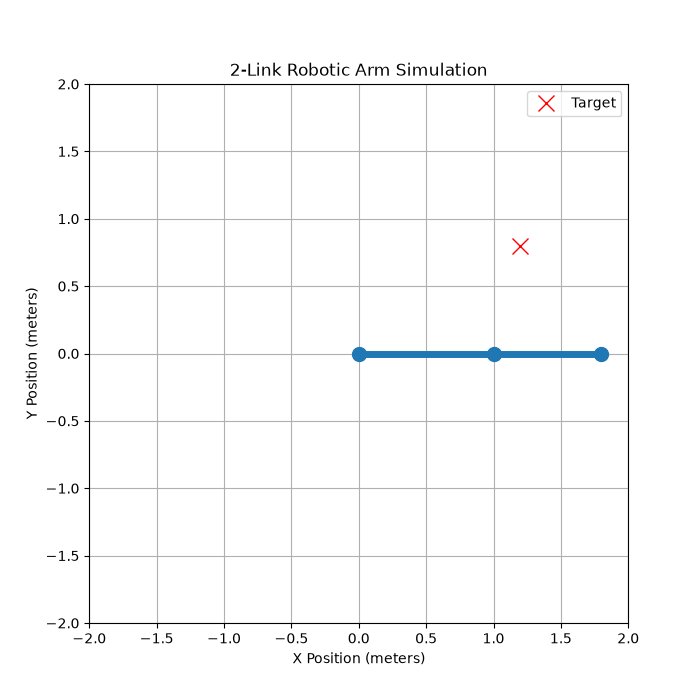
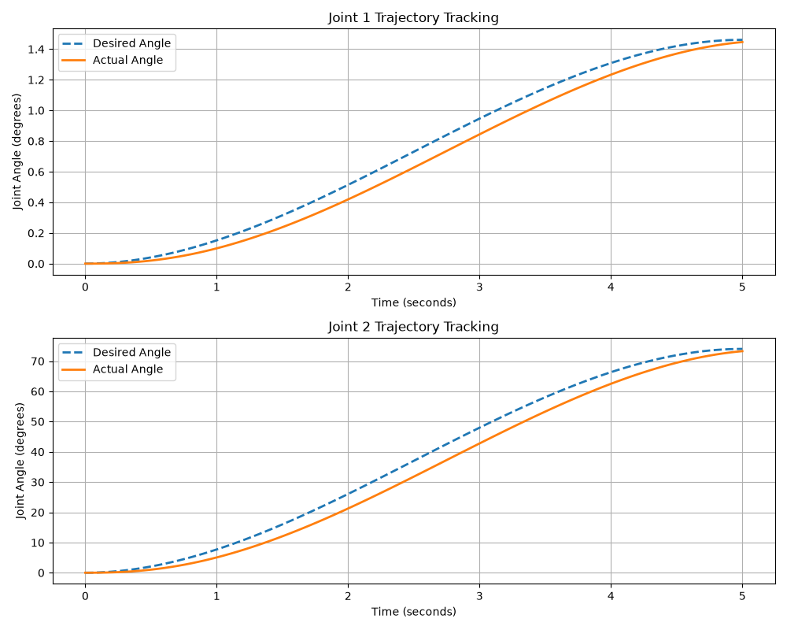
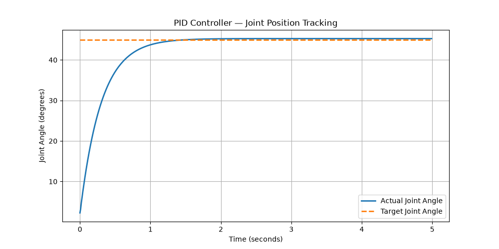

# robot-arm-kinematics-control
# Robotic Arm Kinematics & Feedback Control Simulation

A Python-based simulation of a two-degree-of-freedom (2-DOF) robotic manipulator, integrating forward and inverse kinematics, trajectory planning, and PID feedback control.

The project explores how mathematical modeling and closed-loop control can be used to plan, execute, and evaluate robotic motion.

## Project Overview

Developed a computational framework to simulate the movement and control of a two-link planar robotic arm. The system calculates joint configurations, generates smooth motion trajectories, and evaluates controller performance by comparing desired and simulated joint positions.

**Core capabilities:**
- Forward and inverse kinematics for a 2-DOF robotic manipulator
- Cubic trajectory interpolation for smooth joint-space motion
- Independent PID feedback control for joint trajectory tracking
- Quantitative evaluation of tracking accuracy
- Visualization and animation of robotic motion

## Technical Implementation

### 1. Forward & Inverse Kinematics
Implemented geometric and trigonometric models to calculate end-effector positions from joint angles and determine joint configurations for target positions.

### 2. Trajectory Planning
Generated smooth joint-space trajectories using cubic polynomial interpolation, providing continuous position and velocity profiles between specified configurations.

### 3. PID Feedback Control
Implemented proportional-integral-derivative (PID) controllers to track desired joint trajectories and analyze deviations between planned and simulated motion.

### 4. Performance Evaluation
Evaluated joint-tracking performance using:
- Mean Absolute Error (MAE)
- Root Mean Square Error (RMSE)
- Maximum Absolute Error

Generated visualizations to examine tracking accuracy, trajectory deviations, and controller behavior.

## Simulation Results

### Robotic Arm Animation



### Joint Trajectory Tracking



### PID Controller Performance



## Technologies

- **Language:** Python
- **Numerical Computing:** NumPy
- **Visualization:** Matplotlib
- **Control Methods:** PID feedback control
- **Mathematical Methods:** Forward/inverse kinematics, cubic polynomial interpolation

## Project Structure

```text
robot-arm-kinematics-control/
├── robot_arm.py
├── robot_arm_animation.gif
├── two_joint_tracking.png
├── pid_performance.png
├── README.md
└── .gitignore
```

## Future Development

- Automated controller parameter tuning
- Comparative evaluation of different control strategies
- Extension to higher-degree-of-freedom manipulators
- Integration with physics-based robotic simulation environments

## Installation & Usage

Clone the repository:

    git clone https://github.com/sophiawax23-dev/robot-arm-kinematics-control.git

Navigate to the project directory:

    cd robot-arm-kinematics-control

Install dependencies:

    python -m pip install -r requirements.txt

Run the simulation:

    python robot_arm.py

The simulation performs kinematic calculations,
generates joint trajectories, evaluates PID controller
performance, and saves visualization files.
